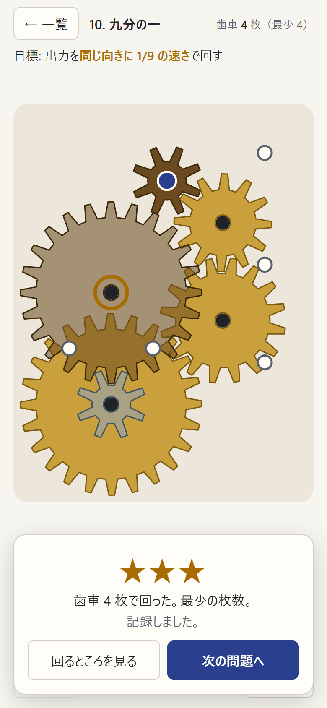
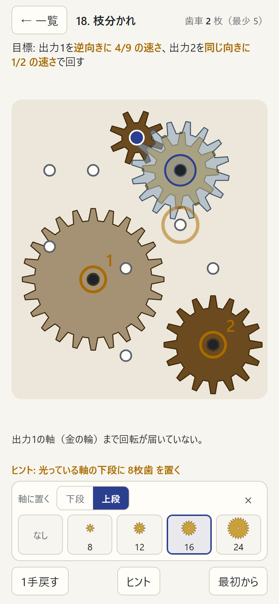
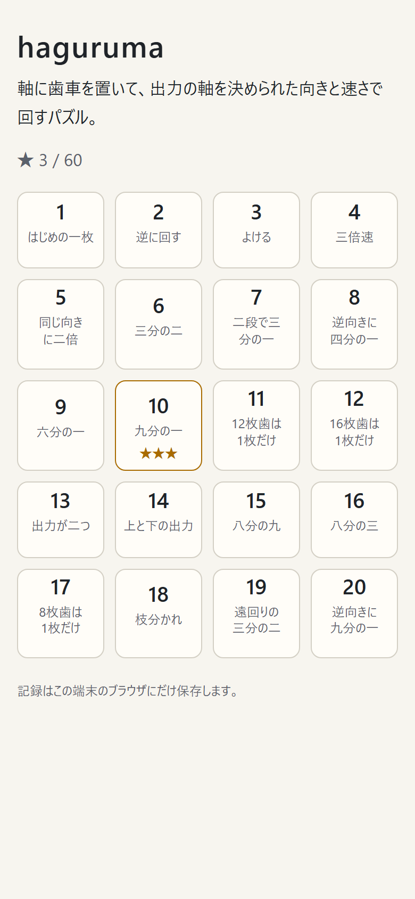

# haguruma

盤の軸に歯車を置いて、出力の軸を決められた **向きと速さ** で回すパズル。
「逆向きに 1/2 の速さ」「同じ向きに 1/9 の速さ」のような目標を、なるべく少ない枚数で作る。同じ軸に上下2段の歯車を付けて比を掛け合わせることもできる。全20問。

**アプリ:** 公開後に URL を書く（スマホ・PC のブラウザで、開くだけで遊べる）



外部のデータは使わず、判定はすべてブラウザの中で行う。
公開版は Content Security Policy で通信（fetch など）をすべて禁じていて、記録はその端末のブラウザにだけ残る。

## 遊び方

| 途中とヒント | 一覧 |
|---|---|
|  |  |

- 歯車の付いていない軸（小さな丸）をタップすると、下に選ぶ欄が開く。歯車は 8・12・16・24 枚歯の4種類
- 青い軸が入力、金の輪が出力。濃い茶色の歯車は最初から付いていて外せない
- 噛み合った歯車は逆向きに、歯数の逆比で回る。2段の問題では、同じ軸の下段（真鍮色）と上段（透ける鋼色）が一緒に回る
- 2枚の軸の距離が、ちょうど半径の和のときだけ噛み合う。少しでもずれて歯先が重なると「ぶつかる」
- 噛み合いが輪になって回る向きや速さが食い違うと「固まって動かない」（3枚の輪など）。どちらも歯車が赤くなって揺れる
- 目標どおりに回ったら、使った枚数で ★ が付く。最少の枚数で ★3、1枚多いと ★2
- 問題によっては、障害物（灰色の丸）、使える枚数の上限（「残」）、2つの出力がある
- **ヒント**: 次の1手の軸を金色に光らせ、「光っている軸の下段に 8枚歯 を置く」のように示す。要らない歯車や違う大きさの歯車が置いてあれば、先に外す・替えるよう示す。ヒントだけでも ★3 で解ける
- 「動きを減らす」設定の端末では回さず、回る軸に向きの矢印を出す

## 作りの要点

### 噛み合いを整数で判定する

[`src/engine/geom.ts`](src/engine/geom.ts)。歯車はモジュール 1（ピッチ円の直径 = 歯数）とし、軸は整数の座標に置く。
噛み合いは「2つの軸の距離の2乗が、半径の和の2乗にちょうど等しい」で判定するので、浮動小数を使わない。
(6, 8) 離れた軸は距離 10 で、8枚歯（半径 4）と 12枚歯（半径 6）が斜めに噛み合う。
それ以外で歯先の円（半径 + 1）が重なれば「ぶつかる」、別の段の歯車がほかの歯車の付いた軸にかぶされば「かぶさる」。

### 回転の伝わり方と、固まり

[`src/engine/train.ts`](src/engine/train.ts)。軸を節点、噛み合いを辺にして、入力軸（回転 1）から幅優先で回転を伝える。
噛み合う2枚は逆向きに歯数の逆比で回り、同じ軸の上下は同じ回転になる。回転は分数のまま計算する（[`rational.ts`](src/engine/rational.ts)）。
すでに回転の決まった軸に別の道から違う回転が届いたら、その2本の道を合わせた輪が「固まる」原因になる。
奇数枚の輪（向きの食い違い）と、2段の歯車で2つの軸を2回つないだときの比の食い違いの、どちらもこれで見つかる。

### 最少枚数を求める

[`src/engine/solve.ts`](src/engine/solve.ts)。★3 の基準になる最少枚数を、反復深化の探索で求める。次の2つの性質で探す範囲を絞る。

- 入力軸につながらない歯車は回転に関係しない。そのため最少の解は、入力側から「回っている歯車と噛み合う」か「同じ軸の別の段」に1枚ずつ足していく順で必ず作れる
- ぶつかり・かぶさり・固まりは、歯車を足しても消えない。問題が出た時点で枝を切れる

20問目（最少6枚）でも約50ミリ秒で終わる。問題には最少枚数を持たせ、`check:puzzles` で探索の結果と照らし合わせる。

### 歯が噛み合って見える角度

[`src/engine/phase.ts`](src/engine/phase.ts)。歯の位置は判定には関係ないが、見た目で歯が相手の谷にはまるように、歯車ごとの最初の角度を決める。
A の中心から B の中心への向きを φ とすると、接点を指す向きを歯の数で数えた値が「A と B で足して 0.5（半歯ずれ）」になればよく、
θB = φ + π − π/TB + (φ − θA)·TA/TB になる。θA が増えると θB は TA/TB の割合で減るので、回転の比とも矛盾しない。
`check:engine` で、全問の解のすべての噛み合いについて、回したあとも歯が谷に向き合っていることを数値で確かめている。

### 問題の作り方

[`tools/design.ts`](tools/design.ts)。軸を無作為に置くだけでは、解ける配置がほとんど出なかった。
そこで、まず入力から歯車を1枚ずつ伸ばした「想定の答え」を作り、その先に出力の軸を置く。そこから噛み合う距離に「おとりの軸」を足して、最少の解を探索で測る。

- 障害物: 想定の答えに当たらない所に置き、外すと解が変わるもの（実際に効いているもの）だけを残す
- 在庫: 在庫なしでは解が複数ある配置に、解を1つに絞るか最少の枚数を増やす上限を探す
- 2つの出力: 想定の答えの途中の歯車から枝分かれさせる

横長の配置は 90° 回して縦長にする。x と y を入れ替える（裏返す）と回る向きが逆になるので、回転にする。
[`tools/trim.ts`](tools/trim.ts) で盤の余白を、最初の歯車と最少解の歯車が収まるまで詰める（詰めても解が変わらないことを確かめる）。

### ヒント

[`src/puzzles/hint.ts`](src/puzzles/hint.ts)。最少の解をすべて求め、いまの盤面といちばん多く重なるものを目当てにする。
目当てにない歯車があれば、先にそれを替える・外す。なければ、目当ての歯車のうち、いま回っている歯車と噛み合うものから置かせる（置くとすぐ回るのが見える）。

## 確かめ方

| コマンド | 確かめること |
|---|---|
| `npm run check:engine` | 手で答えの分かる例（2倍・遊び歯車・斜めの噛み合い・2段で 1/9・奇数の輪と2段の食い違いで固まる・偶数の輪は回る・距離 15/17/18 の境目・かぶさり・はみ出し・障害物・在庫・最少枚数）と、全問の解の噛み合いの角度 |
| `npm run check:puzzles` | 20問すべてで、解けること、最初の盤面が解けていないこと、持たせた最少枚数が探索の結果と同じこと、軸どうしが指で押し分けられるほど離れていること |
| `npm run check:hints` | 20問 × 101 盤面（空の盤面と、でたらめに置いた盤面）から、ヒントをたどるだけで ★3 で解ける。空の盤面からは最少枚数ちょうどの手数 |
| `npm run e2e` | 公開と同じビルドを画面なしの Chrome で開き、本物のマウス・タッチ・キーボードで操作する（14件）。スマホの指で1問目を解いて記録が残る、ぶつかり・固まりの案内、2段の問題を解くと歯車が回る、動きを減らす設定の矢印、★2、在庫、スマホの指で20問目をヒントだけで解く、キーボード操作、保存できないブラウザでも遊べる、CSP で通信が止まる |

## 扱っていないこと

- 歯の形の細かさ。歯は台形で近似していて、インボリュート歯形ではない
- 摩擦・トルク・慣性。回転の比と向きだけを扱う
- ベルト・チェーン・ラック・かさ歯車。平らな盤の上の平歯車だけ
- 偶数枚の輪で、歯の位置が合わなくて組めない場合。判定では回るとし、見た目は最初に通った道で角度を決める

## 開発

```bash
npm install
npm run dev       # http://localhost:5213/
npm run check     # check:engine・check:puzzles・check:hints
npm run e2e       # 画面操作のテスト
npx tsx tools/design.ts --ratio=1/3 --in=8 --out=16 --layers=2 --chain=3 --pegs=7 --min=3 --max=4   # 問題の下調べ
npm run trim                                     # 盤の余白を詰める
npm run build && npm run preview                 # 公開版を http://localhost:5214/ で確かめる
npm run screenshots                              # 公開版から docs/images/ の画像を撮る
```
